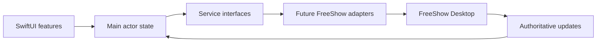

# Architecture

## Foundation decision

Target iPadOS 17+, Swift 6, and Xcode 16+. These are initial project choices, not requirements imposed by FreeShow. Use native SwiftUI, Foundation, and Combine. Support all iPad orientations and window sizes; the eventual operator interface will prioritize landscape. No third-party dependencies are installed in Milestone 1.

The application shell is intentionally small. `FreeShowRemoteApp` owns `AppState` via `StateObject`, and injects that state into `FoundationView`. `AppState` is main-actor isolated and begins disconnected with unknown output. There are no socket connections, permission prompts, persistence, fake service data, or live controls.

## Boundaries

| Component | Responsibility |
| --- | --- |
| SwiftUI features | Display state and collect explicit operator intent |
| AppState | Own preview selection separately from server-confirmed output |
| ConnectionService | Establish a session, authenticate, synchronize, disconnect |
| PresentationService | Read projects/presentations and deliver authoritative snapshots |
| OutputService | Explicit operations that affect live output |
| ScriptureService | Translation lookup, reference/text search, preview, and explicit presentation |
| Future transport adapters | Decode wire payloads, normalize identifiers/indexes, track timeouts and session lifetime |

The service protocols are initial app contracts, not implemented networking clients. They can be supplied as mocks or real adapters through initializer injection when the corresponding owner is introduced. Do not create unused transport layers just to fill a directory tree. Wire DTOs belong with future adapters; domain models do not conform to Codable because upstream payloads are not identical to app models.

## Proposed data flow

Use REST with URLSession for the Milestone 2 command prototype if the target installation exposes it. The default REST port is 5506. Use a separate Remote Socket.IO session, normally port 5510, for project/output pushes in later milestones. REST API and Remote passwords are separate settings. Do not assume API availability implies Remote availability or vice versa.

Socket.IO is not a raw WebSocket protocol. Evaluate a maintained Swift Socket.IO client against the actual server version before adding it. A small native REST client is practical; hand-writing Engine.IO/Socket.IO framing and reconnection is not part of this foundation. No dependency choice is locked in yet.

## State and command semantics

- Model connection progress explicitly: disconnected, connecting, authentication required, synchronizing, connected, reconnecting, failed. An open socket alone is insufficient to report operational readiness.
- Keep local preview selection independent of live output. Fetching a presentation must not invoke a present command. Note that upstream Remote `SHOW` can change desktop selection after an idle period; use a read-only query for purely local browsing where appropriate.
- Keep unknown output distinct from cleared output. On disconnect, retain any last snapshot only with a stale indicator; do not treat it as live truth.
- Identify a slide by presentation, layout, and zero-based flattened layout position. The same slide may appear multiple times. Wire conversions belong only in the adapter: general API indexes are one-based, Remote API channels bypass that conversion.
- Do not optimistically mark a slide live after sending a command. REST 204 is not confirmation that an output changed. Refresh/observe authoritative output.
- Never replay next/previous/present/clear commands automatically after timeouts or reconnection. These actions can cause unintended second changes.
- Reauthenticate, replace subscriptions, and fetch a fresh snapshot after reconnecting. Remote messages do not provide a general request-correlation ID; serialize conflicting requests and scope responses to the current session.
- `clearAll` means FreeShow's broad clear operation, including audio and timers. It is not a black-screen toggle. Restore depends on the desktop's cached state and output lock.

## Scripture expansion

Keep Bible content on the FreeShow side wherever practical. Current source exposes Remote `SCRIPTURE`, `GET_SCRIPTURE`, and `SEARCH_SCRIPTURE`, plus presentation actions. API-backed and local translations have different search paths; local data may need client-side indexing. `ScriptureService` reserves both searches, translation listing, preview, presentation, and navigation without inventing HTTP endpoints.

Plan an early scripture increment after Milestone 2, before building the full operator interface. Its first task is confirming server capabilities on the chosen installation. Search and preview must never issue a presentation command implicitly.

## Deferred implementation decisions

Choose the supported FreeShow release only after live verification. The source baseline is 1.6.8-beta.3, while this development Mac has 1.5.2 installed. Multiple outputs, temporary scripture/PDF output shapes, missing thumbnails, and unsupported project item types need explicit adapter policies. Start with the first active output only if the operator-visible scope is clearly stated.

Add local network usage text, narrowly scoped transport configuration, and `_freeshow._udp` Bonjour declarations when networking/discovery is introduced. Store remembered passwords in Keychain, not logs or preferences. Milestone 1 requests no network access.
